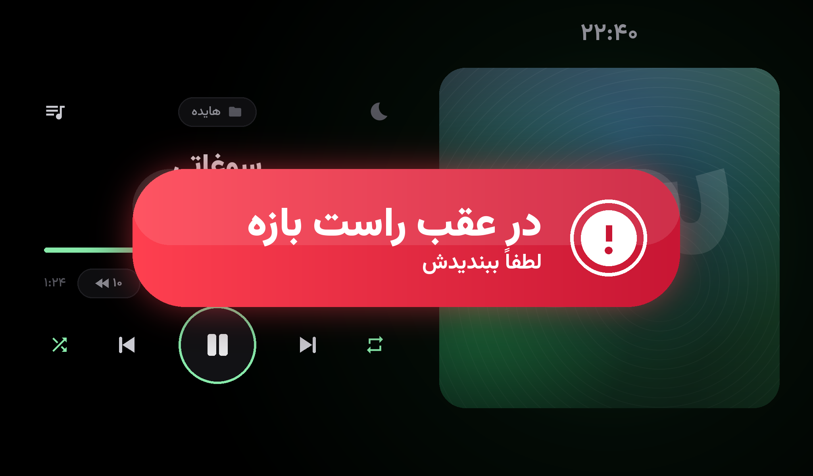
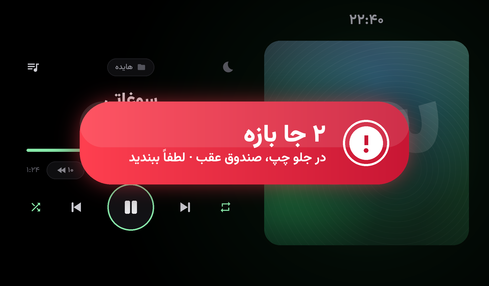
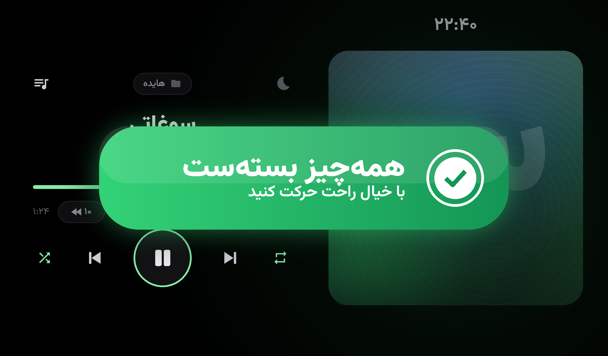

# DoorAlert

**An open door / trunk / hood alert for Android car head units.**

[فارسی](README.md)

When a door, the trunk or the hood is left open, a large, glowing red card pops up in the middle of the screen and says what's open. It appears over whatever app is running (navigation, music, anything) without blocking it. Once everything is closed, it turns green and fades away.

| | |
|:---:|:---:|
|  |  |

## Features

- Large red card with a pulsing glow, big text and a warning badge, easy to see at a glance
- Shows over any app while the app underneath stays usable
- Once everything is closed, the card turns green and leaves on its own after about 2 seconds
- Tap the card to dismiss it. It won't return until something else opens.
- Comes back by itself after every ignition off/on; no need to open the app
- **One-time self-learning setup:** the app learns which signal belongs to each door
- Demo alert and a raw CANBUS data view for troubleshooting

## Compatibility

| | |
|---|---|
| **Car** | JAC S3 |
| **Head unit** | ZQ8003 · board `ZQ_MTK_8007` · Android 9, with a CANBUS decoder |
| **CANBUS type** | `0x100_Jac_ruifeng_S5/S3/S2_Hiworld` |
| **Status** | Tested on a real car: all four doors and the trunk |

The head unit needs a CANBUS decoder box and the vendor `car` service (`android.car.server`).

## Install & set up

1. Download `DoorAlert.apk` from the [latest release](https://github.com/mani-imani/DoorAlert/releases/latest) and install it.
2. Turn the ignition on and open DoorAlert. The setup wizard starts on its own:
   - Close everything and tap **Start**.
   - When asked, open **only that one** door, tap **Record**, then close it.
   - **Skip** anything your car has no sensor for (e.g. the hood).
3. **Turn on the DoorAlert wallpaper** (button on the app's main screen). When the car is switched off, the head unit force-stops every installed app *except* the live-wallpaper app. With this dark wallpaper set, DoorAlert keeps working after every ignition cycle.
4. Done. **Demo** shows the alert at any time.

## Ignition off and on

When the car is switched off, the head unit goes to sleep and first force-stops every user-installed app. A force-stopped app normally doesn't come back by itself. DoorAlert handles this in two ways:

- **DoorAlert wallpaper:** the head unit never stops the app providing the live wallpaper, and the system rebinds it after every start-up.
- **Head unit wake-up signals:** after waking and after a full boot, the vendor system sends broadcasts (`android.car.action.EXIT_SLEEP`, `CAR_BOOT_COMPLETED`) that also reach stopped apps. DoorAlert restarts on those too.

**It's safe for the car.** DoorAlert only reads data and never sends commands to the car. When the head unit sleeps, its CPU fully suspends and DoorAlert holds no wake lock, so it doesn't drain the car battery. The wallpaper is a static image drawn once.

## Troubleshooting

If setup reports *no change detected*, open **Raw data**. If no line turns blue while you open and close a door, the CANBUS box isn't sending door state.

## How it works

- **Data:** the CANBUS box feeds the head unit's `car` service, which stores values under keys whose names vary between CANBUS boxes, which is why DoorAlert finds them itself. During setup DoorAlert reads every key the head unit holds with one `request.dm.get_value_by_prefix` call; afterwards it polls only the learned keys every 250 ms, parsing the reply straight off the binder Parcel ([`CarData.java`](app/src/main/java/ir/maniimani/dooralert/CarData.java)).
- **Learning:** every value is flattened into individual bits. The wizard samples the "all closed" state several times to rule out bits that flicker on their own. Then, for each door, it picks the bit that changes stably when only that door is open ([`Doors.java`](app/src/main/java/ir/maniimani/dooralert/Doors.java)).
- **Alert card:** a small centred window that passes all touches outside itself through to the app below ([`PopupActivity.java`](app/src/main/java/ir/maniimani/dooralert/PopupActivity.java)).

## Other apps for this head unit

- **[BlueTune](https://github.com/mani-imani/BlueTune):** pure-black Bluetooth music with cover art and seeking
- **[DrivePlay](https://github.com/mani-imani/DrivePlay):** USB / SD card player in the same style

## Built with Claude

Built with **[Claude](https://claude.ai)** by Anthropic, on a **Claude Pro** plan. Claude worked through every stage: finding the CANBUS data in the head unit's system code, designing the self-learning setup, designing the alert card and writing the code. I did the real-car testing and made the design decisions.

## Author

**Mani ImaniSanjar** · [GeekMani](https://t.me/geekmani)
[maniimani.ir](https://maniimani.ir) · [GitHub](https://github.com/mani-imani) · [LinkedIn](https://linkedin.com/in/mani-imani)

## License

Code is released under the [MIT](LICENSE) license. The bundled [Vazirmatn](https://github.com/rastikerdar/vazirmatn) font is under the SIL OFL 1.1. This is an independent project, not affiliated with the head unit manufacturer or JAC Motors. Screenshots are UI previews.
