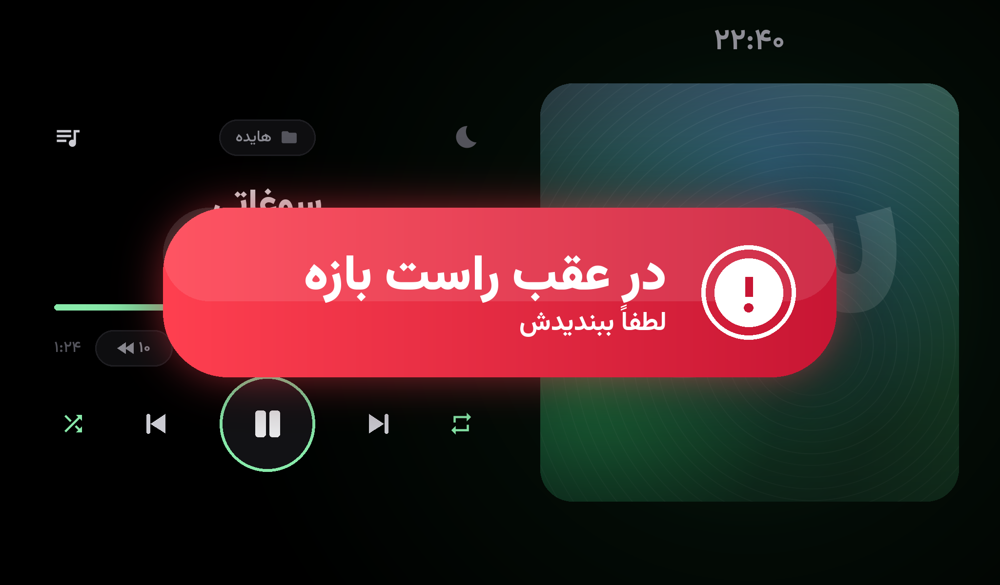
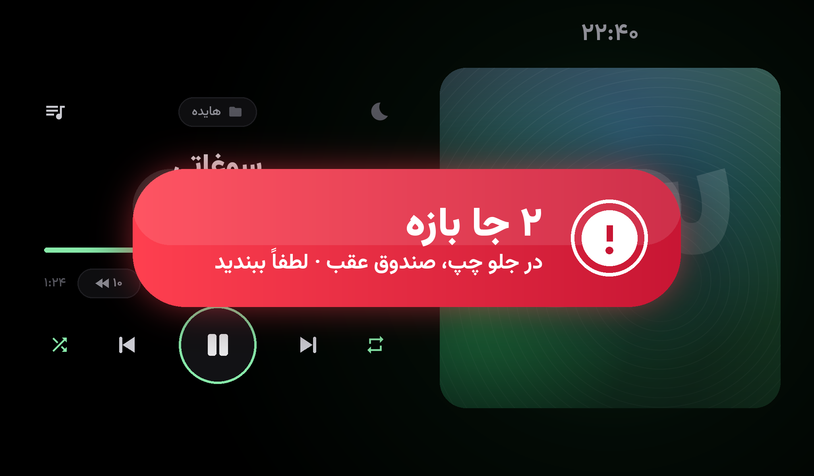
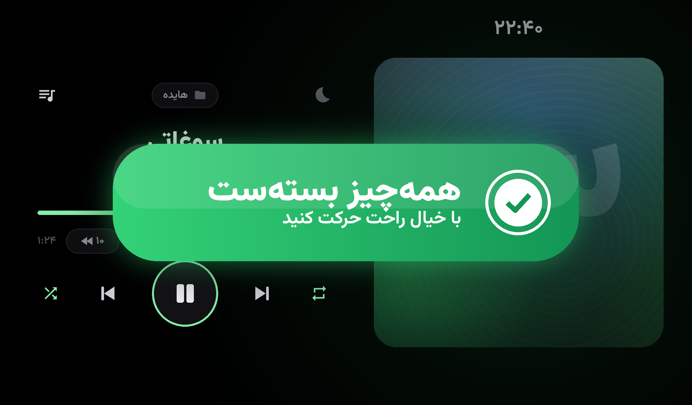

# DoorAlert

**هشدار باز موندن در، صندوق و کاپوت روی مانیتور اندرویدی ماشین**

[English README](README.en.md)

اگه یه در، صندوق یا کاپوت باز بمونه، یه کارت بزرگ قرمز و درخشان وسط صفحه ظاهر می‌شه و می‌گه کجا بازه. کارت روی هر اپی که باز باشه نمایش داده می‌شه (مسیریاب، موزیک و هر چیز دیگه) و جلوی کار با اون اپ رو نمی‌گیره. وقتی همه‌چیز بسته شد، کارت سبز می‌شه و خودش می‌ره.

| | |
|:---:|:---:|
|  |  |

## ویژگی‌ها

- کارت بزرگ قرمز با هاله‌ی نورانی که نبض می‌زنه، متن درشت و علامت هشدار؛ از دور هم دیده می‌شه
- روی هر اپی نمایش داده می‌شه و صفحه‌ی زیرش قابل استفاده می‌مونه
- وقتی همه‌چیز بسته شد، کارت سبز می‌شه و حدود ۲ ثانیه بعد خودش می‌ره
- با زدن روی کارت بسته می‌شه، و تا وقتی یه در دیگه باز نشه دوباره نمیاد
- بعد از هر بار خاموش و روشن کردن ماشین، خودش دوباره فعال می‌شه؛ لازم نیست اپ رو باز کنی
- **تنظیم یک‌باره:** اپ خودش یاد می‌گیره سیگنال هر در کدومه
- نمایش آزمایشی و صفحه‌ی داده‌های خام CANBUS برای عیب‌یابی

## سازگاری

| | |
|---|---|
| **ماشین** | جک S3 (JAC S3) |
| **مانیتور** | ZQ8003 · برد `ZQ_MTK_8007` · اندروید ۹، با جعبه‌ی CANBUS |
| **نوع CANBUS** | `0x100_Jac_ruifeng_S5/S3/S2_Hiworld` |
| **وضعیت** | تست‌شده روی ماشین واقعی: هر ۴ در و صندوق عقب |

لازمه مانیتور یه جعبه‌ی CANBUS داشته باشه که اطلاعات ماشین رو بخونه، و سیستمش سرویس `car` (`android.car.server`) رو داشته باشه.

## نصب و راه‌اندازی

1. فایل `DoorAlert.apk` رو از [آخرین Release](https://github.com/mani-imani/DoorAlert/releases/latest) دانلود و نصب کن.
2. سوییچ ماشین رو باز کن و DoorAlert رو اجرا کن. راهنمای تنظیم خودش باز می‌شه:
   - همه‌ی درها رو ببند و «شروع» رو بزن.
   - به ترتیبی که اپ می‌گه، هر بار **فقط یه در** رو باز کن و «ثبت» رو بزن، بعد ببندش.
   - اگه ماشین برای موردی سنسور نداره (مثلاً کاپوت)، «رد کن» رو بزن.
3. **والپیپر DoorAlert رو فعال کن** (دکمه‌ش توی صفحه‌ی اصلی اپ هست). مانیتور موقع خاموش شدن ماشین همه‌ی اپ‌های نصب‌شده رو کامل می‌بنده، ولی اپ والپیپر رو نمی‌بنده. با این والپیپر تیره، DoorAlert بعد از هر بار خاموش و روشن کردن ماشین خودش فعال می‌مونه.
4. تموم. با «نمایش آزمایشی» هم می‌تونی کارت هشدار رو ببینی.

## خاموش و روشن کردن ماشین

مانیتور موقع خاموش شدن ماشین می‌ره توی حالت خواب و قبلش همه‌ی اپ‌هایی که خودت نصب کردی رو کامل می‌بنده (Force stop). اپ بسته‌شده هم معمولاً بعد از روشن شدن خودش بالا نمیاد. DoorAlert از دو راه این مشکل رو حل می‌کنه:

- **والپیپر DoorAlert:** مانیتور اپی که والپیپر زنده رو نشون می‌ده نمی‌بنده، و بعد از هر بار روشن شدن هم خودش دوباره بالا میارتش.
- **سیگنال‌های بیدار شدن مانیتور:** خود سیستم مانیتور بعد از بیدار شدن و بعد از راه‌اندازی کامل، پیام‌هایی می‌فرسته (`android.car.action.EXIT_SLEEP` و `CAR_BOOT_COMPLETED`) که به اپ‌های بسته‌شده هم می‌رسه. DoorAlert با این پیام‌ها هم دوباره شروع به کار می‌کنه.

**برای ماشین مشکلی ایجاد نمی‌کنه.** DoorAlert فقط داده‌ها رو می‌خونه و هیچ دستوری به ماشین نمی‌فرسته. وقتی مانیتور می‌خوابه، پردازنده‌ش هم کامل می‌خوابه و DoorAlert جلوش رو نمی‌گیره، پس باتری ماشین رو خالی نمی‌کنه. والپیپرش هم یه تصویر ثابته که یه بار کشیده می‌شه.

## عیب‌یابی

اگه توی تنظیم «تغییری دیده نشد»، توی «داده‌های خام» نگاه کن. اگه با باز و بسته کردن در هیچ خطی آبی نشد، یعنی جعبه‌ی CANBUS وضعیت درها رو نمی‌فرسته.

## چطور کار می‌کنه

- **داده‌ها:** جعبه‌ی CANBUS اطلاعات ماشین رو به سرویس سیستمی `car` مانیتور می‌فرسته، زیر کلیدهایی که اسمشون بسته به مدل جعبه فرق می‌کنه؛ برای همین DoorAlert خودش پیداشون می‌کنه. موقع تنظیم، DoorAlert همه‌ی داده‌های مانیتور رو با یه درخواست (`request.dm.get_value_by_prefix`) می‌خونه و بعد از تنظیم فقط کلیدهایی که یاد گرفته رو هر ۲۵۰ میلی‌ثانیه چک می‌کنه و جواب رو مستقیم از Parcel باز می‌کنه ([`CarData.java`](app/src/main/java/ir/maniimani/dooralert/CarData.java)).
- **یادگیری:** همه‌ی مقدارها بیت‌به‌بیت باز می‌شن. اپ اول حالت «همه بسته» رو چند بار نمونه‌برداری می‌کنه تا بیت‌هایی که خودشون تغییر می‌کنن (نویز) رو کنار بذاره. بعد برای هر در، بیتی رو انتخاب می‌کنه که فقط با باز شدن همون در، ثابت و قطعی عوض می‌شه ([`Doors.java`](app/src/main/java/ir/maniimani/dooralert/Doors.java)).
- **کارت هشدار:** یه پنجره‌ی کوچیک وسط صفحه که لمس‌های بیرون از خودش رو به اپ زیرش می‌فرسته ([`PopupActivity.java`](app/src/main/java/ir/maniimani/dooralert/PopupActivity.java)).

## اپ‌های دیگه برای همین مانیتور

- **[BlueTune](https://github.com/mani-imani/BlueTune):** موزیک بلوتوث با تم کاملاً مشکی، کاور و جلو/عقب بردن آهنگ
- **[DrivePlay](https://github.com/mani-imani/DrivePlay):** پلیر فلش و کارت حافظه با همون طراحی

## ساخت از سورس

با هر push به `main` بیلد می‌شه. اگه `versionName` بالا بره، Release هم خودکار ساخته می‌شه.

## ساخته‌شده با Claude

این پروژه با کمک **[Claude](https://claude.ai)** ساخته شد، دستیار هوش مصنوعی شرکت Anthropic، روی اشتراک **Claude Pro**. Claude توی همه‌ی مراحل نقش داشت: پیدا کردن داده‌های CANBUS توی کد سیستم مانیتور، طراحی روش یادگیری خودکار، طراحی کارت هشدار و نوشتن کد. تست روی ماشین واقعی و تصمیم‌های طراحی هم کار خودم بود.

## سازنده

**مانی ایمانی‌سنجر** · [GeekMani](https://t.me/geekmani)
[maniimani.ir](https://maniimani.ir) · [GitHub](https://github.com/mani-imani) · [LinkedIn](https://linkedin.com/in/mani-imani)

## مجوز

کد با مجوز [MIT](LICENSE) منتشر شده. فونت [وزیرمتن](https://github.com/rastikerdar/vazirmatn) با مجوز SIL OFL 1.1 همراه اپ قرار گرفته. این پروژه مستقله و هیچ ارتباطی با سازنده‌ی مانیتور یا خودروسازی جک نداره. عکس‌های این صفحه پیش‌نمایش رابط کاربری‌ان.

